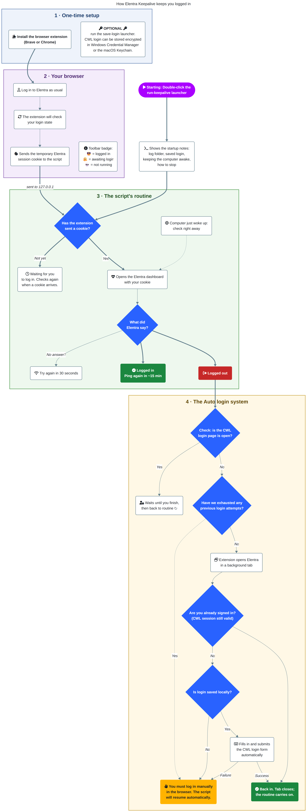

# 🩺 Let's Keep Elentra Alive

Tired of being logged out of Elentra mid-lecture? Keep reading.

## ⚙️ What it do?

**While online, this program will prevent your Elentra session from timing out. It just keeps you logged in as long as it's running!**

> [!TIP]
> **If you're already set up:**
> 1. Double-click `run-keepalive-for-Windows.bat` (or `run-keepalive-for-macOS.command`)
> 2. Log in to Elentra in Brave/Chrome. The extension badge will turn 😎 when you're good.
> 3. Logged out after sleep? With a saved login it can sign you back in by itself. Without one, just log in again.
>

## 🚀 How to intall it

> If you only need to update it, run `git pull` in your downloaded directory and re-load the web extension.

0. **Install [Python](https://www.python.org/downloads/latest/python3.13/).**
1. **`git clone`** or **download and unzip** this
   [repository](https://github.com/lukavuko/keep-elentra-alive/archive/refs/heads/master.zip).
2. **Add the extension.** Open [`brave://extensions`](brave://extensions) or
   [`chrome://extensions`](chrome://extensions), turn on Developer mode, click
   **Load unpacked**, and pick the `brave-extension` folder.
3. **Start the script.** Double-click `run-keepalive-for-Windows.bat` (Windows)
   or `run-keepalive-for-macOS.command` (macOS).
4. **Check the badge** (pin the extension): 😎 = kept alive, 🫠 = running
   but not logged in, 💀 = script not running. Click the icon to make the
   script re-check right away.
5. **Optional: save your CWL login** so you're logged back in after the laptop
   sleeps. Double-click `save-login-for-Windows.bat` or
   `save-login-for-macOS.command`. See [Re-login after sleep](#-re-login-after-sleep).

> **On a Mac:** the first time you open a `.command` file, macOS may say it
> can't be opened. Right-click it, choose **Open**, then **Open** again. If
> macOS asks whether Python may use your keychain, choose **Always Allow** so
> re-login works while you're away. Install Python from python.org: Homebrew's
> Python refuses the automatic dependency install.

## 📋 Requirements

- Python 3.9+
- [`requests`](https://pypi.org/project/requests/) and
  [`keyring`](https://pypi.org/project/keyring/): `pip install -r requirements.txt`
  (the script installs them itself if missing)
- A Chromium-based browser (Brave, Chrome, Edge)

## ⚙️ How it works for the curious minded 

1. **Extension** (`brave-extension/`): an MV3 extension that reads your Elentra
   session cookies, including httpOnly ones, and sends them to
   `127.0.0.1:8765`. CWL login cookies never leave the browser.
2. **Script** (`elentra_keepalive.py`): listens on `127.0.0.1:8765`. Once it has
   a valid cookie, it pings the Elentra dashboard every ~15 minutes (± 3).

#### 🔁 Auto-login feature

When disconnected from the internet or if your computer is asleep, the software
will not be able to keep you logged in. As such, you have the option to store
credentials securely on your local machine in an OS keyring (*a system-level 
encrypted database used by the operating system to securely store and manage 
sensitive credentials*). This can be done with the `save-login` launcher.
These credentials can then be used to log you back in automatically.

This is accomplished by the extension opening Elentra in a background tab. 
If your CWL session is still valid, the tab closes and the routine resumes. 
Otherwise, the extension fills in the login page and tries to log you in up 
up to 3 times over 5 minutes if it does not succeed on the first attempt.

Keynotes
- Your login is stored in an OS keychain (Windows Credential Manager / macOS
  Keychain), never in a file.
- If CWL rejects it, autofill switches off until you save it again, so a
  changed password can't lock your account with retries.
- If CWL asks for MFA (e.g. on a VPN), the re-login waits for it, then gives up.
- Remove any stored credentials with `python elentra_keepalive.py --forget-login`.

The page defaults to `https://ubc.elentra.cloud/`. Change it with the
`ELENTRA_LOGIN_URL` environment variable or `--login-url`. It must start with
`https://ubc.elentra.cloud/`.

## 🤔 Considerations

#### Why an extension?

> While a Chromium browser runs, its cookie file is locked, and the values are
> encrypted so only the browser can read them. The extension hands over the
> cookie directly and catches new logins as they happen.

#### 🔒 Does it store my credentials?

> **Only if you ask it to**, and only in your OS keychain (see
> [Re-login after sleep](#-re-login-after-sleep)). Otherwise it stores only the
> Elentra session cookies, in
> `%LOCALAPPDATA%\elentra-keepalive\cookies.json` (Windows) or
> `~/.local/state/elentra-keepalive/cookies.json` (macOS/Linux). They are sent
> nowhere but Elentra.

#### 🌐 Browser support

> Built in **Brave**. Works in **Chrome** and other Chromium browsers the same way. Firefox is not supported.

#### 🔋 Battery

> **Little to none.** One ping every ~15 minutes.

#### 🛡️ Security

> The script listens on `127.0.0.1` only. Every cookie is checked against
> Elentra before use, so a forged request cannot break a working session.
>
> The extension sends only Elentra cookies, and only to `127.0.0.1`. Its
> re-login tab can only open `https://ubc.elentra.cloud`, and it fills a saved
> login only into that tab. Its `webRequest` permission only observes page
> loads in that tab (address, status code) for the log.
>
> The saved login travels from the script to the extension over `127.0.0.1`,
> guarded by a fixed token.

## ⚠️ Disclaimer

An unofficial hobby project. **Not affiliated with, endorsed by, or supported by
any party.** It does nothing more than keeping a tab open and refreshing
it. It touches your CWL login only if you save one, and then only to fill
the CWL login form for you. Use it within your institution's
acceptable-use policies.

IN addition, parts of this project were built with AI. A human reviewed and tested
everything before publishing.

## 📄 License

[MIT](LICENSE). No warranty.
